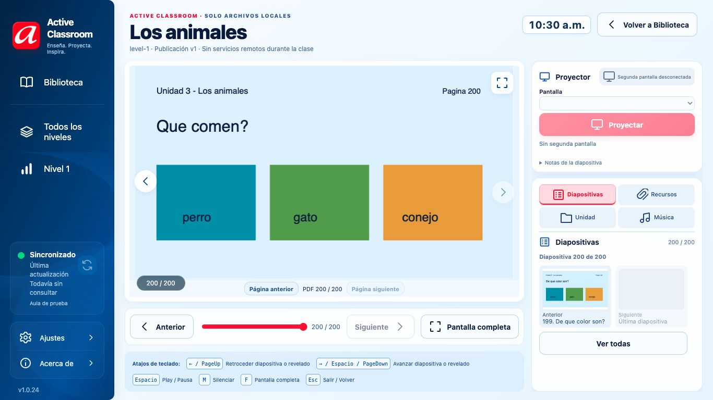
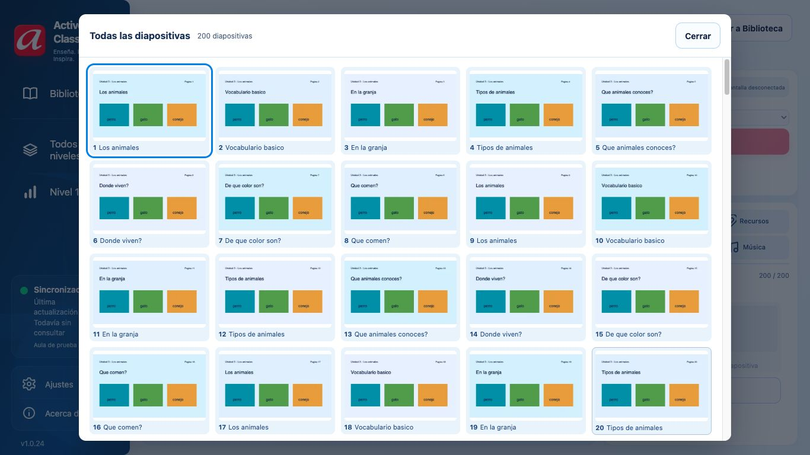

# Active Classroom 1.0.24 — pantalla del maestro

Issue: https://github.com/gonhercaral-cpu/desarrollo-proyectos/issues/37

**Estado final:** código integrado y 1.0.24 publicado; paquetes firmados y endpoint público verificados. Un cliente nativo aislado de CI configurado como 1.0.23 detectó la nueva versión. La instalación en computadoras físicas de los salones requiere evidencia de esos equipos.

## Implementación y alcance

- Miniaturas reales anterior/siguiente, posición y galería accesible con selección directa. Conserva teclado configurable y proyección independiente.
- Reloj local del maestro con formato de la región del equipo, refresco alineado al minuto y limpieza al cerrar.
- Pestañas para diapositivas, recursos asociados, recursos de unidad y música; un scroll por lista. Los nodos de audio/música permanecen montados al cambiar de pestaña.
- Conserva identidad, credenciales del equipo, contenido descargado, backend y actualizador. Sin cambios en Firebase ni despliegues web.

## Delegación real y revisión

- Claude Code implementó SlideNavigator, SlideThumbnails, estilos de galería, integración inicial y pruebas. Una segunda ejecución corrigió rasterizado, límites de lectura, cancelación, timeout y fallback sin IntersectionObserver.
- Antigravity realizó la consulta de arquitectura y generó TeacherWorkspace, markup por pestañas, estilos y pruebas como parche textual. Sus intentos de edición directa se detuvieron por permisos del CLI; no se habilitaron comandos arbitrarios. El propietario autorizó expresamente compartir los tres archivos de interfaz usados como contexto.
- Codex definió contratos ligados al Issue, revisó e integró propuestas, corrigió selectores globales y detalles de layout, adaptó pruebas offline/nativas, verificó la interfaz y preparó versión/entrega.
- Contratos, diagnósticos y propuestas están en el directorio local ignorado `.orquestacion/teacher-20261117/`; no se publican transcripciones ni secretos.

## Componentes principales

Desktop: `src/player/ClassroomPlayer.ts`, `SlideNavigator.ts`, `slide-thumbnails.ts`, `slide-navigator.css`, `player.css`, `src/ui/TeacherWorkspace.ts` y `player-view.ts`. Pruebas: navegación, miniaturas, reloj/pestañas y adaptación de los casos existentes de audio, offline y layout WebKit. Versiones package/npm/Tauri/Cargo sincronizadas en 1.0.24.

## Validación local de Codex

- Base offline, sincronización/publicaciones, dispositivos, configuración y updater: 125/125.
- Player (audio, vídeo, música, GIF, atajos, miniaturas/galería): 127/127.
- Proyección: 25/25. Revelados: 9/9. Interfaz: 11/11.
- TypeScript/Vite y assets PDF.js: compilación correcta, 2/2 comprobaciones de bundle.
- Lint específico de Desktop: correcto. El lint general, repetido sobre el código final, conserva los mismos 137 errores y 37 advertencias previos en otros módulos; Desktop no registra errores ni advertencias. No se modifican esos módulos.
- Test de release local: tres casos de `system-media.test.mjs` fallan por el Bash 3.2 de macOS al interpretar el script de empaquetado Linux. Los casos de empaquetado aprobaron posteriormente en VALIDATION sobre Ubuntu.
- Navegador integrado de macOS con el reproductor y PDF.js reales: PDF sintético local de 200 páginas, miniaturas 320×180, galería, Inicio/Fin/Escape, salto a página 200, recursos extensos (60 filas), reloj y pestañas. Tamaños observados: 1280×720, 1024×768, 920×640 y 1366×768; sin desbordamiento horizontal y con una sola región de scroll en la lista activa.
- Esta prueba visual no certifica GPU, sonido ni instalación física en Ubuntu/Zorin de los salones.

## Rendimiento

Renders seriales; miniaturas de hasta 320×200; un PDF auxiliar abierto; carga al entrar en pantalla, sin montar reproductores completos en cada tarjeta. La galería construye botones una vez y actualiza solo posición/selección. Caché LRU de 48 imágenes fuera de las visibles; conserva las visibles para evitar ciclos de expulsión. Revoca URLs y destruye PDF, observadores, tareas y reloj al cerrar. Límite de fuente de miniatura: 32 MiB y 40 millones de píxeles de imagen; si se supera o el archivo falla, muestra vista previa no disponible y la clase sigue funcionando. PDFs protegidos o apertura de más de 20 segundos fallan sin bloquear la cola. Los placeholders son estáticos para evitar animaciones de GPU en cientos de tarjetas.

## Integración, publicación y equipos

Rama de integración: `codex/teacher/issue-37`, basada en `main` cuando la versión publicada era 1.0.23. Los cambios locales ajenos de la copia original se conservaron. El merge y las evidencias de validación/publicación se registran a continuación. La detección e instalación en CI se distinguen de los equipos físicos de los salones.

## Referencias de integración y evidencia visual

- Implementación: `911e2e0f7386ac4a9e9a5de4875cccd8481173bb`.
- Ajuste de consumo GPU: `edd343536a57be13f647c9c9dc2cf6fca0fa4f9e`.
- [PR #38 integrado](https://github.com/gonhercaral-cpu/desarrollo-proyectos/pull/38), merge `1c3ba9c113f0cee5d0066b0696c1ed8585287358`.
- [VALIDATION del merge exacto](https://github.com/gonhercaral-cpu/desarrollo-proyectos/actions/runs/44150284122).
- La primera ejecución de rama fue sustituida por la validación del merge final; sus resultados parciales no certifican la publicación.

Capturas del reproductor real con PDF sintético local, sin contenido privado de clases:

## Diagnóstico del primer intento de paquetes

El intento 1 de VALIDATION terminó con fallo en AppImage/Wayland de Ubuntu 24.04. El caso independiente de VideoRenderer completó 15 ciclos de vídeo y falló al reanudar el siguiente: el reloj quedó en 1.012 s y el frame presentado en 1.041 s, sin MediaError y con datos locales disponibles. Ocurrió antes de construir la nueva pantalla del maestro; MediaRenderer, VideoRenderer y el observador de frames conservan el código de 1.0.23. Esto delimita el fallo, pero no demuestra por sí solo que sea transitorio.

Antes de detenerse aprobaron las cuatro combinaciones .deb/AppImage y X11/Wayland de Ubuntu 22.04, su actualización desde 1.0.12 con configuración/caché conservadas, y .deb X11/Wayland más AppImage X11 en Ubuntu 24.04. La matriz no alcanzó Ubuntu 26.04 en ese intento.

Se inició una segunda validación completa del mismo SHA, sin cambiar tests, timeouts, límites de memoria ni código multimedia. El fallo del intento 1 no se considera una validación satisfactoria ni habilita la publicación.

## Comparación del runtime multimedia

Con autorización expresa del propietario, Claude Code revisó en modo de solo lectura MediaRenderer, VideoRenderer, el observador de reproducción, el escenario de aceptación y el diagnóstico sintético de CI. Identificó una detención del pipeline nativo tras seek/reanudación; recomendó contrastar repetidamente los runtimes anterior y candidato antes de atribuir el fallo a una incidencia transitoria. No se añadió un watchdog ni se relajó la aceptación.

Codex comparó los bytes de los componentes multimedia de ambos paquetes Debian, verificando antes el SHA-256 público de 1.0.23. El launcher y `system-media.sh` son iguales. Cambian bibliotecas de gst-plugins-base recogidas por la compilación desde APT: en Ubuntu 24, 1.24.2-1ubuntu0.6 → 1.24.2-1ubuntu0.7; también cambian las revisiones equivalentes de Ubuntu 22 y 26. Las revisiones nuevas corresponden a la [actualización de seguridad USN-9094-1 publicada por Ubuntu el 16 de noviembre](https://ubuntu.com/security/notices/USN-9094-1). Es una variable real del entorno, pero no demuestra la causa del fallo.

Se lanzó un [diagnóstico independiente](https://github.com/gonhercaral-cpu/desarrollo-proyectos/actions/runs/44191532870) desde `codex/teacher-runtime-comparison` (`de78fa2`, `9a1ba62`). Usa los AppImage original 1.0.23 y candidato 1.0.24 con un mismo adaptador de pruebas construido desde el código integrado, sobre Ubuntu 24/Wayland: cinco procesos/contenedores sin red por runtime, con el mismo generador de contenido sintético, escenarios y límites originales. Esto compara bibliotecas y hooks; no equivale a ejecutar la interfaz antigua completa. El flujo solo tiene permisos de lectura y no firma, certifica ni publica. La rama diagnóstica no se integra en `main`.

El [primer arranque del diagnóstico](https://github.com/gonhercaral-cpu/desarrollo-proyectos/actions/runs/44190460519) se detuvo antes de ejecutar el reproductor porque GitHub ya no conservaba el artefacto del intento 1 tras el rerun. Se corrigió la descarga para esperar los nuevos artefactos de VALIDATION; ese fallo de infraestructura no es un resultado multimedia.

## VALIDATION completa del segundo intento

El [intento 2 del merge exacto](https://github.com/gonhercaral-cpu/desarrollo-proyectos/actions/runs/44150284122/attempts/2) aprobó todos los jobs obligatorios el 17 de noviembre: autorización/reglas Firebase en emuladores, conversión Office en contenedor, tests/Cargo/paquetes Linux y el agregado VALIDATION completa. No se modificaron código, tests ni límites entre ambos intentos.

- Ubuntu 22.04, 24.04 y 26.04: instalación limpia mediante APT y Gdebi, validación Dpkg/ABI, launcher, desinstalación y AppImage offline.
- Las 12 combinaciones de tres versiones Ubuntu × `.deb`/AppImage × X11/Wayland aprobaron reproducción H.264/AAC real, controles, Range, proyección, música, navegación, scroll y comprobaciones de recursos/memoria.
- Codex comprobó los 12 resultados JSON nativos: todos `ok: true`, con 20 reaperturas acotadas por caso (240 en total), navegación interactiva y música verificadas.
- Al finalizar esas 20 reaperturas, los máximos entre casos fueron 214,6 MiB del proceso principal y 628,2 MiB del WebKit del maestro, dentro de los topes de esa fase (256 y 768 MiB). Son muestras de esa comprobación, no máximos de todas las fases posteriores de estrés.
- Ubuntu 22.04 y 24.04: actualización real de paquete 1.0.12 → 1.0.24, conservando configuración y caché. Son contenedores sintéticos, no computadoras físicas de salones.
- También aprobaron los casos nativos de pantalla completa Wayland con dos monitores virtuales y el actualizador instalado de prueba 1.0.6 → 1.0.7, con reinicio, identidad y preferencias conservadas.
- Artefactos certificados: `active-classroom-validation-1c3ba9c113f0cee5d0066b0696c1ed8585287358` (ID 14381240840). Informes completos: ID 14381580182. RELEASE consumió estos paquetes; la comparación adicional usa los mismos bytes.

La aprobación de esta validación conserva el registro del fallo inicial. Antes de iniciar RELEASE se revisaron también las repeticiones adicionales del candidato.

Codex verificó localmente el certificado con `validation-artifacts.mjs verify`: repositorio, run, SHA, versión, tamaños y hashes corresponden al merge aprobado. La comparación binaria de los 531 archivos regulares del payload Debian entre los dos intentos dio cero diferencias, incluidos el ejecutable y los 528 archivos de códecs/arranque. El segundo resultado no se obtuvo cambiando esos componentes.

## Resultado de las repeticiones adicionales

El diagnóstico 44191532870 terminó en verde para ambos runtimes. Codex descargó sus informes y comprobó los diez resultados JSON nativos y sus hashes de entrada:

| AppImage / runtime | Ejecuciones aprobadas | Reaperturas acotadas adicionales |
| --- | --- | --- |
| 1.0.23 publicado | 5/5 | 100 |
| 1.0.24 certificado | 5/5 | 100 |

El SHA-256 del AppImage candidato coincide con el certificado de VALIDATION, y el del control 1.0.23 coincide con el asset publicado. Los jobs usan runners separados de la misma imagen CI y generan sus medios con la misma receta sintética. Es evidencia de repetibilidad de esos escenarios; la causa del atasco inicial sigue sin estar demostrada. El fallo no volvió a aparecer en la segunda matriz completa ni en las cinco ejecuciones adicionales del candidato. Se mantuvieron los límites de reproducción, memoria y recursos originales.

## Publicación verificada

[Active Classroom 1.0.24](https://github.com/gonhercaral-cpu/desarrollo-proyectos/releases/tag/active-classroom-v1.0.24) se publicó el 17 de noviembre de 2026 a las 23:57:35 UTC mediante [RELEASE 44203617340](https://github.com/gonhercaral-cpu/desarrollo-proyectos/actions/runs/44203617340), terminado en verde. El gate comprobó la VALIDATION del commit exacto antes de firmar. El tag `active-classroom-v1.0.24` apunta a `1c3ba9c113f0cee5d0066b0696c1ed8585287358`.

Artefactos públicos descargados y comprobados por Codex:

| Paquete | Bytes | SHA-256 |
| --- | ---: | --- |
| `Active.Classroom_1.0.24_amd64.deb` | 151650400 | `d7fd46658fc472a622513d2da5aa292d5c6812eafcf0915d6696c94300239069` |
| `Active-Classroom-1.0.24-x86_64.AppImage` | 185825784 | `1c84ea0e44e3ab3b5842cc4d391d2b10240cb037a55a22a58991f5d6006f79d4` |

Cada paquete incluye `.sig` y `.sha256`; el séptimo asset es `latest.json`. Los tamaños y hashes descargados coinciden con el certificado de VALIDATION, los checksums publicados y los digests de GitHub. RELEASE verificó criptográficamente ambas firmas con la clave pública existente y la versión firmada 1.0.24. La publicación es estable, pública y marcada como latest.

El [endpoint existente del actualizador](https://github.com/gonhercaral-cpu/desarrollo-proyectos/releases/latest/download/latest.json) devolvió HTTP 200 y versión 1.0.24; el target `linux-x86_64-deb` apunta al instalador oficial de este release. La firma del manifiesto coincide con el archivo `.sig` publicado y contiene la versión firmada correcta. La clave y el mecanismo de actualización existentes se conservaron. No hubo despliegues de Firebase ni del sistema web.

## Detección nativa y estado de los salones

La [comprobación posterior al release, 44203875075](https://github.com/gonhercaral-cpu/desarrollo-proyectos/actions/runs/44203875075) aprobó. Desde la rama diagnóstica (`80633dd`) se creó un ejecutable temporal que incluye directamente `app_updater.rs`, sin cambios respecto de 1.0.23. El contexto de ese cliente se configuró como versión 1.0.23 y paquete `.deb`, con la clave y el endpoint oficiales. Ejecutó la función real `classroom_app_update` con acción `check`; no ejecutó `install` ni `restart`.

El resultado nativo fue `ok: true`, `nativeProductCheck: true`, `phase: available`, `newVersion: 1.0.24`, `installed: false` y `physicalClassroom: false`. Después, el verificador criptográfico nativo del proyecto comprobó los dos paquetes descargados de la publicación y sus firmas/versiones, con resultado correcto. El job y su evidencia JSON terminaron en verde.

| Etapa | Evidencia |
| --- | --- |
| Código implementado | PR #38 integrado en `main`, merge `1c3ba9c` |
| Release publicado | `active-classroom-v1.0.24`, RELEASE verde, siete assets |
| Disponible para descarga/actualizador | Paquetes descargados con hashes correctos y `latest.json` público HTTP 200, versión 1.0.24 |
| Detectado por un cliente | Cliente nativo aislado de CI configurado como 1.0.23: `available`, nueva versión 1.0.24 |
| Instalado en Linux de prueba | Instalación limpia 1.0.24 en Ubuntu 22/24/26; actualización 1.0.12 → 1.0.24 en Ubuntu 22/24, configuración/caché conservadas |
| Detectado/instalado en salones físicos | Sin evidencia verificable de esos equipos en esta sesión |

## Pendientes y límites reales

- Verificación física en Ubuntu/Zorin y comprobación de las versiones de los salones: no se dispone de una sesión remota ni de acceso administrativo a la telemetría de esos equipos. La entrega está disponible mediante el actualizador `.deb` existente; no se afirma una instalación física sin evidencia.
- La causa exacta del atasco de vídeo del primer intento no está demostrada con las trazas disponibles. No se reprodujo en la segunda matriz completa ni en las cinco ejecuciones adicionales del candidato; todos esos casos aprobaron con el mismo código y límites. Se conserva el diagnóstico y esta incertidumbre, sin afirmar que una corrección de producto lo resolvió.
