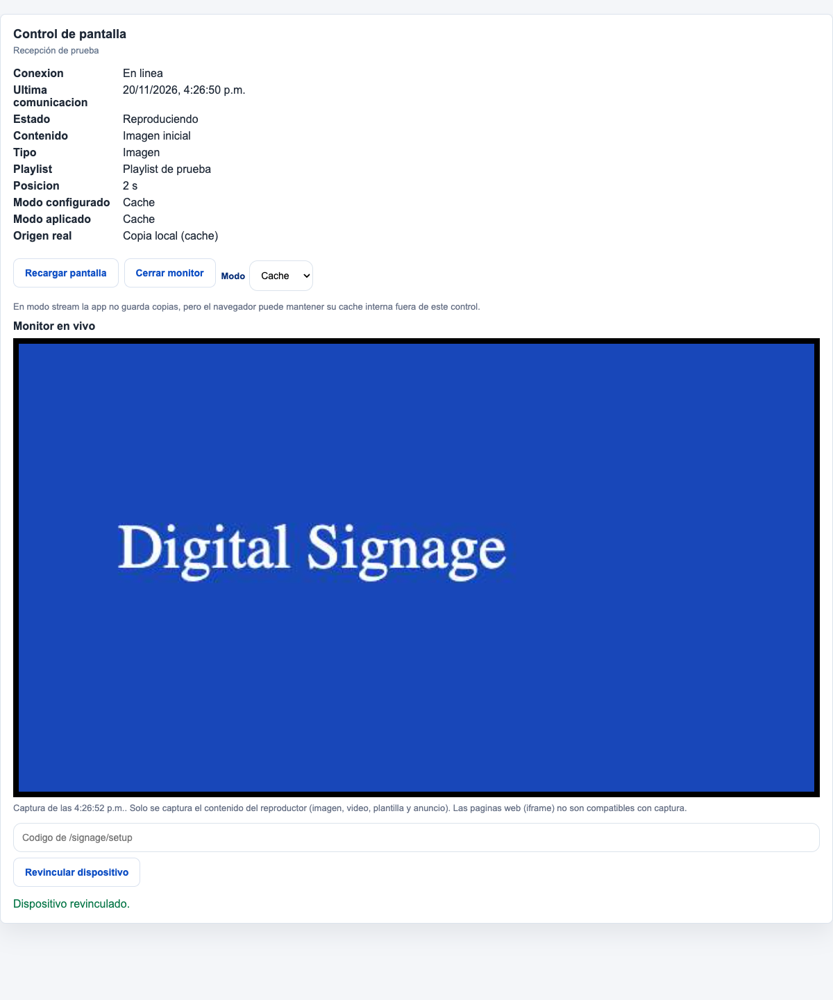

# Digital Signage — control y monitoreo por dispositivo

Implementación del [Issue #40](https://github.com/gonhercaral-cpu/desarrollo-proyectos/issues/40), 20 de noviembre de 2026. Código preparado para revisión; la publicación en producción y la validación física son pasos separados.

## Funciones

| Función | Implementación | Límites |
| --- | --- | --- |
| DS-01 | Recarga de configuración, campañas y playlist desde el servidor, sin reiniciar navegador/SO. Orden autenticada con ID único, confirmación, auditoría y estados pendiente/recibida/ejecutada/fallida/expirada. | TTL de 120 s; una orden pendiente por dispositivo. Una ejecución interrumpida queda sin confirmación y expira. |
| DS-02 | Telemetría del DOM y captura real del elemento visible del reproductor cada ~10 s mientras existe una sesión administrativa. Incluye el acomodo visible, no la playlist oculta. | JPEG hasta 640 px/100 KB; no captura escritorios, iframes, DRM ni recursos que impidan leer el canvas. |
| DS-03 | Recarga, desplazamiento vertical y navegación mediante rutas del mismo origen, limitados al contenido y sesión seleccionados. Comprueba ID/URL antes de actuar. | Scroll/navegación requieren `allowInteraction`. La recarga externa se puede solicitar, pero se reporta como resultado no verificable si el origen impide confirmarla. Sin ejecución arbitraria de código. |
| DS-04 | Modo caché/stream independiente, sincronizado y confirmado por telemetría. Incluye fondos/logos de acomodos. | Caché de aplicación: 64 MiB/archivo, 256 MiB/dispositivo, dos descargas simultáneas y margen de cuota del 20 %. Archivos incompatibles o demasiado grandes usan la URL de red; el origen real lo distingue. |
| DS-05 | Revinculación transaccional: conserva ID administrativo, nombre, playlist, configuración, asociaciones y modo; rota credencial y recompone acomodos publicados con el guard existente del plantel. | El navegador nuevo debe abrir `/signage/setup`. No se recupera ni se copia la credencial privada desde el panel. |
| DS-06 | Contenido visible, tipo, playlist, estado, posición, modo aplicado, origen observado, error y última comunicación. | La caché HTTP del navegador no es caché persistente de la aplicación. Sin evidencia del origen se informa «No confirmado». Los acomodos reportan origen no determinado si no se verifican todos sus recursos. |

Los dispositivos existentes conservan su reproducción legacy hasta que el administrador los revincule. Las nuevas operaciones requieren la identidad segura. No se elimina ningún registro para migrar.

## Arquitectura y seguridad

Se reutilizan React, las playlists/campañas y publicaciones de acomodos existentes, Firestore, Cache Storage y Functions `us-central1`.

- `signagePairing`: crea sesiones privadas de diez minutos; el código solo puede consumirse por un administrador activo. El navegador genera una credencial aleatoria de 256 bits antes de crear la sesión; el servidor guarda únicamente su hash.
- `signageControl`: comprueba Firebase Auth y el perfil administrativo activo en cada operación. Gestiona modo, órdenes, revinculación y sesiones visuales.
- `signagePlayerExchange`: verifica la credencial técnica y su generación antes de entregar configuración, órdenes o manifiestos, o de aceptar telemetría/capturas/ACK. No requiere habilitar otro proveedor de Firebase Auth.
- `digitalSignageControl`, `digitalSignageControlIdentities` y `digitalSignageControlPairings` son colecciones exclusivas del servidor. Las reglas niegan lectura/escritura directa, incluso al SDK cliente de administración. Los historiales de órdenes son privados.
- Las capturas están asociadas a una sesión exclusiva de un administrador: lease de 45 s renovado cada 15 s. Cerrar, ocultar o desmontar el panel solicita su cierre; si se pierde la conexión, el lease caduca. La interfaz descarta imágenes de más de 20 s.
- La telemetría usa tiempo de recepción del servidor; después de 75 s se considera obsoleta. El intercambio del reproductor se realiza cada diez segundos y el heartbeat público se limita a treinta segundos. La lectura de configuración/manifiesto reutiliza la última respuesta; los manifiestos solo se retransmiten al cambiar su revisión.
- Las órdenes se reclaman en una transacción, quedan asociadas a una sesión del reproductor y se pueden volver a entregar a esa sesión si se perdió una respuesta. La deduplicación local evita repetir la ejecución. El ACK se conserva para reintentar sin volver a ejecutar.
- Revincular elimina el mapeo de la credencial anterior y deshabilita su lectura/heartbeat legacy. Los bytes que un navegador ya descargó no se pueden retirar de un equipo que permanece desconectado.
- No se relajan CSP, reglas de origen, X-Frame-Options ni permisos del navegador. La política Hosting actual puede impedir incrustar algunas páginas aunque la operación sea compatible en un entorno local. Debe validarse el sitio concreto antes de habilitarlo en producción.

La caché evita descargas duplicadas, valida respuesta HTTP, MIME, tamaño y descarga completa, revalida ETag cuando está disponible y conserva la entrada anterior si falla la sustitución. Sin ETag vuelve a consultar la URL al vencer el intervalo de revalidación. No hay hashes de autor en los assets legacy: no se promete verificación criptográfica del archivo original ni reanudación HTTP Range. Una descarga interrumpida se reinicia de forma segura; nunca publica una entrada parcial. Cambiar a stream no borra archivos persistidos. El navegador puede mantener su propia caché interna.

## Delegación y procedencia

- **Antigravity:** consulta de auditoría técnica y recomendaciones sobre identidad, comandos, caché, captura, orígenes y pruebas. Terminó con código 0 y `status: success`. Dos revisiones adicionales agotaron su tiempo: no se usan sus salidas parciales ni se presentan como validaciones.
- **Claude Code:** primer contrato de ocho archivos: panel, integración visual, hook de control, captura, caché y pruebas unitarias. Segundo contrato de tres archivos: integrar el reproductor sobre `main` conservando acomodos, prioridades, pausas y guards. Ambas ejecuciones terminaron con código 0 y sin error del proveedor. No ejecutó pruebas ni publicó cambios.
- **Codex:** auditoría del checkout, diseño del protocolo, backend de seguridad y transacciones, reglas, integración de servicios, revisión de los dos parches y su procedencia, correcciones de ACK/captura/recarga/caché, integración sobre `main`, pruebas y preparación de revisión.

Los auxiliares trabajaron en snapshots locales con ramas efímeras, contratos asociados al Issue y herramientas Read/Edit/Write; no tuvieron shell, secretos de Firebase, push, merges, tags ni despliegues. Parches revisados: ocho archivos/100810 bytes y tres archivos/39560 bytes. Los intercambios privados permanecen fuera de Git.

El checkout inicial era `1100fdc`, anterior a las mejoras de Digital Signage de `main`. La integración final parte de `e27919a` en un worktree separado: conserva las mejoras de campañas, ítems repetidos, duración, acomodos y guards de reproducción. Los cambios locales preexistentes del propietario permanecen en el checkout original.

## Archivos y servicios



Vista aislada del componente con los estilos existentes y datos de emuladores; no corresponde a una pantalla de producción. La comprobación visual enfocada terminó con código 0.

Código de aplicación: `SignagePlayer.jsx`, `DigitalSignageAdmin.jsx`, `SignageDevicesPanel.jsx`, nuevos `SignageDeviceControl.jsx` y `useSignageControl.js`, `useRoomLayoutPlayback.js`, servicios `controlService.js`, `devicesService.js`, `pairingService.js`, `roomLayoutsService.js`, utilidades `signageCache.js` y `signageCapture.js`.

Backend: nuevo `functions/digitalSignage.js` y cuatro líneas de registro en `functions/index.js`. Firestore: únicamente límites privados nuevos en `firestore.rules`. Pruebas: configuración aislada `firebase.signage-test.json`, pruebas de control/browser/caché/captura y actualización de pruebas de reglas/acomodos.

No se modifican código ni clientes de Active Classroom, dependencias/lockfiles, autenticación compartida, índices, Storage Rules, Hosting, workflows ni releases. Servicios de producción actualizados: **ninguno**.

## Validación

- **Firestore y Storage emulados:** 153 pruebas aprobadas: 11 del backend y 142 de reglas. Incluyen carreras de claim, código consumido/expirado, revocación, conservación de playlist/modo/asociaciones/acomodos, deduplicación, pérdida de respuesta, ACK ajeno/tardío, TTL, sesiones/capturas, permisos y pantallas inactivas.
- **Pruebas unitarias del módulo:** 89 aprobadas entre caché/captura, campañas, duraciones, playlists, importación de Drive, acomodos y servicios de publicación.
- **Compilación Vite:** aprobada sobre la integración en `main`; conserva avisos previos de tamaño de chunks/importaciones.
- **ESLint de archivos modificados:** aprobado. El lint global del checkout original tenía 137 errores y 37 advertencias ajenos al cambio. En el worktree de `main`, el comando global además requiere `typescript-eslint` del paquete separado de Active Classroom; no se modifica ese módulo para resolverlo.
- **Navegador:** prueba integral aprobada en Chrome con Auth, Functions, Firestore y Storage locales (188,7 s). Verifica revinculación conservando ID/playlist, blob persistido, reproducción offline, captura recibida en el panel, recarga con ACK, stream sin blob, vuelta a caché sin borrar archivos, scroll/navegación/recarga web, limitación explícita de captura iframe, acomodo visible con telemetría/captura del overlay, retirada del acomodo y cierre efectivo del monitor. Las solicitudes ajenas a localhost se bloquean; el sondeo de conectividad de Firebase se responde localmente.
- **Dispositivos físicos:** ninguno disponible en esta sesión. Chrome y emuladores no sustituyen pruebas en Ubuntu, Zorin o Android, desconexiones prolongadas, cuotas reales o aceleración/DRM del hardware.

Reproducción de pruebas:

```sh
node --test tests/signage-*.test.mjs tests/digital-signage-*.test.mjs
npm exec --package=firebase-tools@15.27.0 -- firebase emulators:exec --config firebase.rules-test.json --project security-rules-audit --only firestore,storage 'node --test --test-concurrency=1 tests/digital-signage-control.test.cjs tests/firebase-rules.test.mjs'
npm exec --package=firebase-tools@15.27.0 --package=playwright@1.65.1 -- firebase emulators:exec --config firebase.signage-test.json --project security-rules-audit --only auth,firestore,functions,storage 'node --test tests/digital-signage-browser.test.cjs'
npm run build
```

La prueba de navegador requiere Chrome local (`SIGNAGE_CHROME_PATH` permite indicar otra ubicación) y Playwright disponible en el PATH de npm o mediante `PLAYWRIGHT_MODULE_PATH`. Las pruebas de emuladores/navegador se omiten si faltan sus requisitos; una omisión no constituye una aprobación.

## Publicación y pendientes

El propietario debe revisar el diff sensible de reglas/backend y aprobar el despliegue conforme a las instrucciones del proyecto. Firebase CLI no tenía una sesión autenticada durante esta ejecución. No se han publicado Functions, reglas, Hosting, clientes ni releases; no hay verificación posterior a un despliegue ni merge a `main`.

Una vez aprobadas las pruebas y habilitado el acceso de despliegue, el orden previsto es publicar exclusivamente las tres callables nuevas, las reglas y el Hosting web. No hacen falta Storage Rules, índices, updater ni releases Tauri para este reproductor web. El código y los dispositivos legacy siguen funcionando antes de revincular; los códigos legacy que estén pendientes al cambiar el panel deben regenerarse en el nuevo `/signage/setup`.

Antes de extenderlo a toda la instalación, validar una pantalla física de cada plataforma y los sitios web concretos autorizados. Probar consumo de memoria con vídeos grandes, cuota disponible, offline prolongado y retorno de stream a caché. La restricción de 64 MiB evita lecturas persistentes excesivas; no debe confundirse el modo elegido con una garantía de disponibilidad offline para todo formato/tamaño.
