# Colaboración multiagente dirigida por Codex

## Estado de esta implementación

Configuración preparada, **sin habilitar ni desplegar**. La delegación requiere
`MULTIAGENT_ENABLED=true`, un controlador autorizado y claves del proveedor.
No se han creado Secrets, Environments, rulesets, Issues, PRs ni ejecuciones remotas.
No hay ningún workflow con escritura para los auxiliares ni publicación automática
de ramas/PRs. El código de la aplicación, Firebase y los flujos de releases existentes
no forman parte de estos cambios.

Las pruebas locales verifican el protocolo y las barreras. No sustituyen una prueba
real autenticada de cada proveedor. Hasta realizarla, el estado es **integración
pendiente de credenciales y prueba piloto**, no integración operativa demostrada.
Los resultados locales concretos están en [multiagent-validation.md](multiagent-validation.md).

## Arquitectura y autoridad

```mermaid
flowchart LR
    H[Propietario: autoriza habilitación] --> C[Codex: plan y contrato]
    C --> I[Comentario autorizado en Issue o PR]
    I --> G[Gate: identidad, permisos, contrato y SHA]
    G --> A[Claude Code Action o Gemini CLI Action]
    A --> P[Artefacto: parche e informe sin revisar]
    P --> R[Codex: procedencia y diff]
    R --> B[Rama aislada codex/agente/tarea]
    B --> T[Codex y CI: pruebas]
    T --> PR[PR revisable]
    PR --> M[Codex integra con controles de GitHub]
```



Codex es el único responsable técnico de planificación, asignación, consulta de
resultados, revisión, integración y validación final. Claude implementa tareas pequeñas;
Gemini puede implementar o aportar una segunda revisión. No tienen autoridad para
replanificar, delegar, aprobar ni integrar. Un auxiliar no puede aprobar al otro.
La aprobación del propietario gobierna la habilitación de escritura y despliegues.

GitHub identifica cuentas y tokens, **no puede demostrar que un comentario fue escrito
por un modelo concreto**. `CODEX_CONTROLLER_LOGINS` identifica la cuenta humana que
opera Codex; hay que mantener el contrato y su autoría trazables. No se crea una
identidad ficticia de Codex ni se conceden bypass a bots.

## Inventario del repositorio y compatibilidad

| Área | Situación y tratamiento |
| --- | --- |
| React/Vite | `src/`, estilos y assets existentes; build local, sin Hosting deploy |
| Firebase | Hosting, Firestore/índices y Storage configurados en raíz; no se cambian |
| Cloud Functions | Dos codebases: `functions/` default y `drive/`; Node 24 |
| Active Classroom | Web, administración, Tauri y procesador; conservar contratos y pruebas específicas |
| `active-classroom-linux.yml` | Push a ramas con paths y tags `active-classroom-v*`, compilación nativa, firma y publicación de releases por tag; conservado intacto |
| `active-classroom-updater-key.yml` | Manual; administra firma mediante `UPDATER_BOOTSTRAP_TOKEN`; conservado intacto |
| Nueva CI | Pull requests y manual; lectura, sin secretos, sin firma ni despliegue |

**Un push de Codex que toque Active Classroom puede disparar el flujo Linux existente**,
que incluye pasos con claves de firma. La arquitectura evita que los auxiliares hagan
push; no elimina ese comportamiento histórico. Antes de publicar un PR de esa área,
el propietario debe revisar la exposición de secretos del flujo existente y sus
condiciones de firma. No crear tags para probar esta integración. No ejecutar el bootstrap.

## Activación manual, después de la aprobación del propietario

1. Revisar y publicar esta configuración en la rama predeterminada mediante PR de Codex.
   Los disparadores no estarán disponibles correctamente hasta que el workflow esté allí.
   La implementación local parte de `codex/active-classroom-linux-ci`, que contiene
   desarrollo funcional aún no integrado en `main` según las referencias locales.
   Revisar primero el PR de arquitectura contra esa rama o esperar su integración
   independiente; no incluir esos cambios funcionales en la aprobación de arquitectura.
2. En Settings > Actions, mantener los permisos por defecto del `GITHUB_TOKEN` en lectura.
   No habilitar «Allow GitHub Actions to create and approve pull requests» para este sistema.
   Activar secret scanning y push protection si el plan lo permite.
   Permitir las acciones oficiales fijadas por SHA y sus dependencias transitivas; revisar
   estas últimas, porque un pin del wrapper no fija todo el software que instala.
3. Crear el Environment **`multiagent-readonly`**, con required reviewers humanos,
   prevención de autoaprobación y deployment branches limitadas a la rama predeterminada.
   Comprobar que el plan de GitHub ofrece estas protecciones para este repositorio.
   Si no están disponibles, mantener la delegación apagada hasta acordar otra barrera.
   GitHub puede crear un Environment sin protecciones si solo se lo referencia: no basta
   con que el nombre exista en YAML.
4. Guardar allí, únicamente como Environment Secrets:

   | Secret | Origen y alcance |
   | --- | --- |
   | `ANTHROPIC_API_KEY` | Anthropic Console; workspace dedicado, presupuesto reducido |
   | `GEMINI_API_KEY` | Google AI Studio/Gemini API; proyecto separado, API y cuotas restringidas |

   Solo hace falta la clave del proveedor que se vaya a probar. No se requieren claves
   OpenAI para este protocolo, ni Firebase Admin, GCP service accounts, WIF, OAuth de
   Claude, GitHub App auxiliar o PAT dentro de Actions. Se pasa el `github.token`
   temporal de lectura a Claude para evitar que solicite un token App con más permisos.
5. Configurar Repository Variables:

   | Variable | Valor |
   | --- | --- |
   | `MULTIAGENT_ENABLED` | `false` durante revisión; `true` solo después de aprobación |
   | `CODEX_CONTROLLER_LOGINS` | Logins humanos autorizados, separados por comas; sin `*` |
   | `MULTIAGENT_CLAUDE_MODEL` | ID exacto habilitado y presupuestado en tu cuenta Anthropic |
   | `MULTIAGENT_GEMINI_MODEL` | ID exacto habilitado y presupuestado en tu cuenta Gemini |

   Los modelos se eligen expresamente: no se inventa disponibilidad de una cuenta.
   Solo se exige el modelo del proveedor seleccionado. No incluir flags en estas variables.
6. Aplicar las protecciones de ramas siguientes y hacer una prueba piloto por proveedor.
   Registrar URL del run, modelo, coste observado, artefacto y resultado de Codex.

No guardar secretos de estos proveedores como Repository Secrets si se necesita la
barrera del Environment: otros workflows del repositorio podrían referenciarlos.
Los Secrets de producción existentes requieren su propia revisión de alcance.

## Protección de main y de la rama predeterminada

La prohibición técnica inmediata para auxiliares es el token sin `contents: write`.
Las instrucciones Markdown no son una protección de ramas. Configurar manualmente un
ruleset activo para `main` y la rama predeterminada, con:

- PR obligatorio, al menos una revisión humana y CODEOWNERS para archivos sensibles.
- Invalidar aprobaciones con nuevos commits; exigir aprobación del último push y resolver conversaciones.
- Bloquear force-push y eliminación. Sin bypass para GitHub Actions, Claude, Gemini o Apps auxiliares.
- Checks obligatorios de la nueva CI: `Agent security contracts`,
  `Application validation (no deploy)` y `Firebase rules (emulators only)`.
  Seleccionar los nombres reales después de su primera ejecución exitosa.
- Si se restringen actores de actualización, reservar la integración a la cuenta
  controladora que opera Codex. No dar ese permiso a las identidades auxiliares.
- Proteger tags `active-classroom-v*` para que solo el proceso humano de release pueda crearlos.

`CODEOWNERS` propone `@gonhercaral-cpu`, propietario que consta en el remote local.
Verificar que tenga write/admin y ajustar el responsable antes de activar la exigencia.
Si el autor es el único CODEOWNER, debe añadirse otro revisor con acceso: no puede
autoaprobarse. No se han consultado ni modificado los rulesets reales de GitHub.
No activar checks obligatorios que aún estén rojos por problemas previos.

## Contrato de delegación desde Issues y PRs

Codex divide el trabajo en subtareas sin archivos superpuestos y publica **un comentario
nuevo**, con la primera línea exacta y JSON sin cercas Markdown:

```text
/codex-delegate claude
{
  "version": 1,
  "kind": "implement",
  "objective": "Corregir el formato de una utilidad sin cambiar su API pública.",
  "paths": ["src/utils/example.js", "tests/example.test.mjs"],
  "acceptance": "Conservar entradas válidas y cubrir el caso descrito en el Issue.",
  "tests": "node --test tests/example.test.mjs; npm run lint; npm run build"
}
```

Sustituir los archivos del ejemplo por archivos reales. Para Gemini, usar
`/codex-delegate gemini`. `kind` admite `implement` o `review`. Los comandos en `tests`
son datos para Codex, **nunca se ejecutan como shell del workflow**.

El gate verifica la allowlist y permisos actuales write/maintain/admin del actor,
del autor del comentario y de quien solicita una reejecución; rechaza bots, IDs
inválidos, otros eventos y ejecuciones desde ramas distintas de la predeterminada.
Abrir/editar un Issue, añadir una etiqueta o escribir `@claude`/`@gemini-cli` no delega.
Editar un comentario no dispara un run; para reintentar, crear otro contrato o usar dispatch.
Cada intento consume presupuesto y exige revisión del Environment.

Los PRs solo admiten `review`, hacia la rama predeterminada y desde el mismo repositorio.
Se proporciona su diff como **texto**, se registra su SHA y no se hace checkout ni se
ejecuta código del PR en el job con claves de modelo. No se procesan forks.
Las implementaciones nacen de un Issue y del SHA de la rama predeterminada fijado
por el gate. Codex deberá revalidar si el PR o la base cambian después del análisis.

También se puede disparar manualmente con el número del Issue/PR y el ID del comentario:

```bash
gh workflow run multiagent-delegate.yml --ref main \
  -f issue_number=123 -f comment_id=456789
```

Usar la rama predeterminada real si no es `main`. Esto **sí invoca un modelo y tiene coste**.
No ejecutar hasta completar la activación. Un mismo contrato puede correr varias veces;
no hay deduplicación de costes. La concurrencia limita a un run activo y un pendiente;
GitHub puede sustituir pendientes, no es una cola durable ni tiene garantía FIFO.

## Consulta, revisión, ramas y PRs desde Codex Cloud

Conectar el repositorio en Codex y configurar un entorno con Node 24, npm, Git y Java 21.
Para una sesión de trabajo basta instalar las dependencias de los módulos relevantes:

```bash
npm ci --ignore-scripts --no-audit --no-fund
npm ci --prefix functions --ignore-scripts --no-audit --no-fund
npm ci --prefix drive --ignore-scripts --no-audit --no-fund
npm ci --prefix active-classroom-desktop --ignore-scripts --no-audit --no-fund
node --test tests/multiagent-security.test.cjs
```

Las claves Anthropic/Gemini permanecen en GitHub Environment Secrets; no se copian a Codex.
Los entornos Cloud pueden tener restricciones de red y de duración de secretos.
Verificar el modo concreto del entorno: una conexión GitHub en la interfaz no garantiza
que el terminal tenga `gh`, identidad autenticada ni permiso para dispatch o push.
No copiar tokens a archivos o variables persistentes para eludir esa restricción.

Desde una sesión que disponga de GitHub CLI y autenticación autorizada, comprobar:

```bash
gh auth status
gh repo view --json nameWithOwner,defaultBranchRef
gh run list --workflow multiagent-delegate.yml --limit 10
gh run view RUN_ID --json status,conclusion,headSha,event,url,jobs
gh run download RUN_ID --name multiagent-claude-RUN_ID-1 --dir /tmp/proposal-RUN_ID
```

Si `gh` no tiene acceso, utilizar las herramientas GitHub disponibles en Codex o la UI
de GitHub para comentar, ejecutar y descargar. Este repositorio no instala un puente
oculto entre Codex Cloud y esas APIs ni simula que una herramienta no disponible funciona.
Codex debe contrastar repositorio, workflow, autor, intento, conclusión y artefacto contra
GitHub; los campos de `assignment.json` y `result.json` por sí solos no prueban procedencia.

Antes de ejecutar o aplicar nada, leer `report.md`, `assignment.json`, `result.json` y
`proposal.patch`. No usar `source`, `eval`, scripts o comandos suministrados por el agente.
El estado de salida es `proposal-unreviewed` y `testsExecuted=false`.

En un checkout de control confiable, utilizar **el verificador de Codex**, no una copia
incluida por el artefacto. Crear otra worktree sin tocar cambios de la sesión actual:

```bash
# BASE_SHA debe coincidir con el contrato y con el run contrastado en GitHub.
git fetch origin
git worktree add -b codex/claude/issue-123-RUN_ID /tmp/codex-issue-123 BASE_SHA
cd /tmp/codex-issue-123
node .github/agents/proposal.cjs check /tmp/proposal-RUN_ID
# Tras inspeccionar el diff, aplicar exactamente el mismo artefacto comprobado:
git -c core.hooksPath=/dev/null apply --index /tmp/proposal-RUN_ID/proposal.patch
git diff --cached --check
git diff --cached
```

`check` no aplica ni ejecuta la propuesta: exige checkout limpio, SHA base correcto,
rutas exactas y modos regulares. Rechaza binarios, symlinks, ejecutables, submódulos,
renombrados y archivos fuera de la política. Una revisión entrega parche vacío y no
se aplica. Si la rama predeterminada avanzó, Codex decide rebase o nueva delegación,
resuelve los conflictos y vuelve a comprobar la versión final; nunca usar force-push a main.

Codex instala dependencias del checkout revisado, ejecuta pruebas pertinentes y crea
un commit revisable. La publicación siguiente es una **acción de escritura del controlador**,
requiere la autorización del propietario y no se ejecuta automáticamente:

```bash
git push -u origin codex/claude/issue-123-RUN_ID
gh pr create --draft --base main --head codex/claude/issue-123-RUN_ID \
  --title "Corrección de utilidad delegada" --body-file /tmp/pr-body.md
```

Preparar `/tmp/pr-body.md` con `.github/PULL_REQUEST_TEMPLATE/agent-proposal.md`.
Codex consulta `gh pr diff NUMERO` y `gh pr checks NUMERO`, revisa el SHA final, confirma
aceptación y gestiona la integración con las protecciones del repositorio. No activar
auto-merge ni usar bypass de administrador. Ningún auxiliar hace merge.

## Validación y costes

| Control | Límite |
| --- | --- |
| Gate / ejecución de modelo | 3 / 15 minutos |
| Concurrencia de delegación | Un run activo global, sin fan-out ni cron |
| Claude | 12 turnos y `--max-budget-usd 2` por invocación |
| Gemini | 12 turnos; no se anuncia un tope monetario por run que la Action no ofrece |
| Propuesta | 12 archivos, parche 200 KB, informe 64 KB |
| Artefactos | 7 días; solo parche, contrato, metadatos e informe, sin transcripciones |
| CI | 5 minutos de política; 15 de app y 15 de emuladores, en jobs independientes |

Configurar presupuestos y cuotas pequeños en ambos proveedores y límites de gasto de
GitHub Actions. Un timeout o un número de turnos no constituye un tope mensual de dinero.
Las alertas de facturación pueden no detener el consumo: verificar la barrera efectiva
del plan contratado. Reintentos manuales pueden multiplicar el coste. Gemini usa el modo
no interactivo `--yolo` de la Action oficial; la lista de herramientas quita shell y red.
No confundir esos controles con aislamiento del sistema operativo o filtrado de salida
de red. Un runner hospedado y efímero solo contiene las claves del proveedor seleccionado,
el token de lectura y acceso transitorio a artefactos; revisar la respuesta como no confiable.

Pruebas mínimas de Codex: seguridad del protocolo, lint, build y pruebas unitarias
relevantes. Para reglas/roles/accesos, siempre emuladores con `security-rules-audit`,
nunca el proyecto de `.firebaserc`. La nueva CI ejecuta `npm run test:rules` usando
Firebase CLI 15.27.0 y Java 21 sin credenciales. El workflow histórico conserva sus
tests nativos, de Office y transacciones; no se disparan ni se declaran comprobados aquí.

Si hay cambios de Active Classroom, añadir pruebas del área afectada y los builds web,
admin o Tauri pertinentes. Pruebas de escritorio reales, firma y publicación siguen
requiriendo el entorno específico. Los auxiliares no modifican reglas, auth, infraestructura
ni lockfiles mediante este protocolo; Codex atiende esas subtareas directamente.

## Apagado y recuperación

Cambiar `MULTIAGENT_ENABLED=false`, cancelar runs activos/pendientes y revocar o rotar
la clave si hubo exposición. Cambiar la variable no cancela automáticamente jobs ya
autorizados. No reejecutar un workflow antiguo después de una revocación; el gate consulta
permisos actuales pero una aprobación de Environment anterior no sustituye la revisión.
No recuperar propuestas fallidas como si fueran válidas. Volver a delegar con un contrato
acotado y revisar de nuevo. Cualquier futura automatización que publique ramas o PRs debe
presentarse en otro diff y obtener aprobación explícita antes de conceder escritura.

## Referencias oficiales verificadas el 19 de octubre de 2026

- [Claude Code Action: código y action.yml fijados](https://github.com/anthropics/claude-code-action/tree/5eb090f3c3afd701a0672cd32981197ca27688f6).
  Se usa prompt explícito (agent mode) y token propio de lectura; no el flujo estándar de menciones con escritura.
- [Claude CLI: herramientas, turnos y presupuesto](https://code.claude.com/docs/en/cli-reference).
- [Gemini CLI Action v0.1.22](https://github.com/google-github-actions/run-gemini-cli/tree/f77273f4c914e4bf38440cf36a0369cb64a37489).
- [Configuración Gemini CLI 0.64.0](https://github.com/google-gemini/gemini-cli/blob/v0.64.0/packages/cli/src/config/settingsSchema.ts).
  CLI fijada; no usar `latest` sin revisar compatibilidad y seguridad.
- [Seguridad de GitHub Actions](https://docs.github.com/en/actions/reference/security/secure-use) y
  [rulesets](https://docs.github.com/en/repositories/configuring-branches-and-merges-in-your-repository/managing-rulesets/about-rulesets).
- [Entornos Cloud actuales](https://learn.chatgpt.com/docs/environments/cloud-environments),
  [Codex Cloud legacy](https://learn.chatgpt.com/docs/environments/cloud-environment) y
  [acceso de red legacy](https://learn.chatgpt.com/docs/cloud/internet-access).
  La configuración efectiva depende de la modalidad y permisos de tu cuenta.
